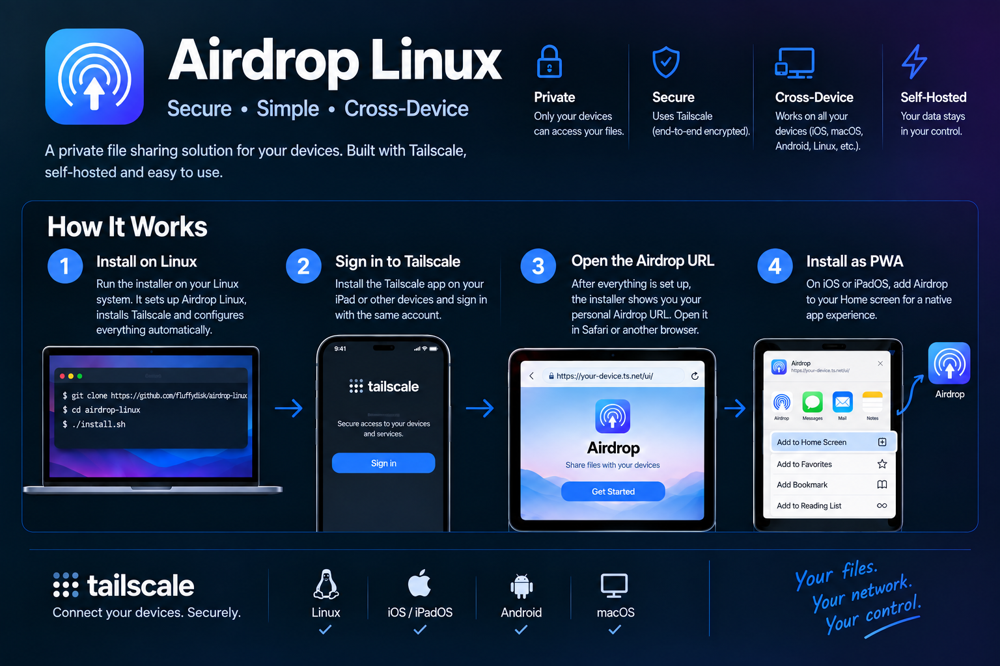
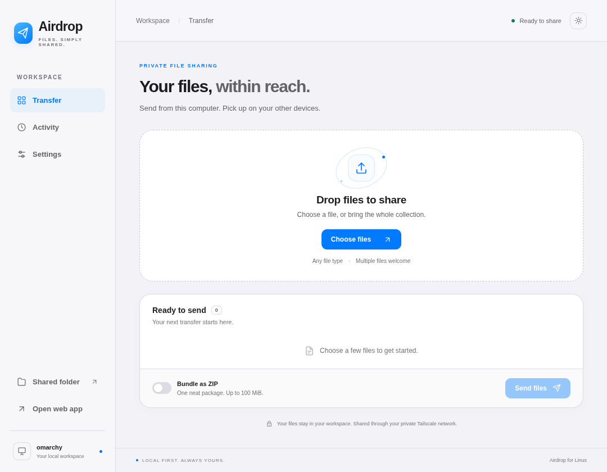

# Airdrop Linux

A self-hosted file and clipboard sharing system that runs over Tailscale. It is designed as a private alternative to AirDrop for sharing files and clipboard content between iPad, iPhone, Android, and Linux/desktop devices. It includes an iOS-inspired PWA interface, real Web Push notifications, bidirectional clipboard synchronization, ZIP transfers, and an optional Linux tray companion.



## Architecture

- **[dufs](https://github.com/sigoden/dufs)** — lightweight HTTP file server for serving the shared files
- **Tailscale** — secure private networking between devices, with `tailscale serve` providing HTTPS termination
- **Node.js + Express + web-push** — push notifications, atomic uploads, and streamed ZIP downloads
- **JSZip** — ZIP creation in the PWA, CLI, and desktop app (bundled locally)
- **Electron** — optional Linux tray app for the local server
- **PWA** (`ui/`) — iOS-inspired interface with a Service Worker for push notifications and the Android Web Share Target API

## Quick start

```bash
git clone https://github.com/fluffydisk/airdrop-linux.git
cd airdrop-linux
./install.sh
```

The installer automatically:

- Detects your Linux distribution and installs missing dependencies (Node.js, dufs, clipboard utilities, and Tailscale)
- Creates one application root at `~/.local/share/airdrop`, with separate shared files, application code, configuration and state
- Installs the npm dependencies
- **Generates a fresh VAPID key pair for your installation** so users never inherit someone else's credentials
- Installs and starts the systemd services using your current user account when systemd is available
- Sets the installing user as the Tailscale Linux operator
- Authenticates the machine with Tailscale when needed (the installer pauses for the normal browser login)
- Configures Tailscale Serve automatically for the Airdrop file server (`/`) and push server (`/push`)
- Prints the exact Airdrop HTTPS URL to open on the user's other devices
- Installs terminal helpers (`airdrop`, `copy-clipboard`, `paste-clipboard`) in `~/.local/bin` and automatically detects Wayland vs. X11 for clipboard access

The only external step that may be required is enabling HTTPS certificates for your tailnet in the Tailscale admin console. Tailscale Serve requires HTTPS certificates; once they are enabled, re-running `./install.sh` completes the Serve configuration automatically.

### Requirements

- A Linux distribution with systemd for automatic service management
- A [Tailscale](https://tailscale.com/) account
- `curl` and `sudo` access
- Tailscale HTTPS certificates enabled for the tailnet when using automatic Serve setup

The included Docker test suite covers Ubuntu, Debian, Fedora, Rocky Linux, openSUSE Tumbleweed, Arch Linux, Alpine Linux, and Void Linux. Docker containers do not provide a normal desktop session or a full systemd environment, so clipboard integration and real service startup are not completely exercised by the container tests.

## Application storage and upgrading

Everything lives under `${XDG_DATA_HOME:-~/.local/share}/airdrop` by default:

```text
airdrop/
├── files/             Shared files and optional .clipboard.txt
├── app/
│   ├── ui/            PWA assets (read-only over HTTP)
│   ├── server/        Node server, CLI and dependencies
│   └── desktop/       Optional Electron application
├── config/server.env VAPID identity and server configuration
├── state/
│   ├── push/          Subscriptions and file tracking
│   └── desktop/       Desktop preferences and Chromium profile
├── backups/legacy/    Original directories retained after migration
└── migration.json     Resumable migration journal
```

You may delete **all contents of `files/`** without removing the app, credentials or subscriptions. The clipboard is shared user content and is cleared too. Keep the `files/` directory itself while dufs is running. Uploads recreate a missing directory, but deleting the directory during a transfer interrupts that transfer. Never clear the entire application root to clear shared files. Use **Open shared folder** in the desktop app to reach the correct directory.

For an existing installation, quit Airdrop using the tray's **Quit** action, then run:

```bash
./install.sh
./install-desktop.sh  # If you use the optional desktop app
```

The main installer copies files from `~/AirdropShare`, keeps the VAPID identity and subscriptions from `~/airdrop-push`, and preserves the desktop profile from `~/.config/airdrop-desktop`. Existing names with different contents are numbered; identical copies are reused. It checks file hashes before moving the original directories, including the old desktop binary, to `backups/legacy/`. Temporary duplicate storage is needed during migration. A failed preparation leaves originals intact; systemd service configuration is restored if startup or validation fails. Close the desktop app and pause transfers during the upgrade. Symbolic links and conflicting VAPID identities need resolving before migration.

Without systemd, originals remain in place: stop the old manual services, run the preparation again, start and verify the new services, then run `node "$AIRDROP_HOME/app/server/scripts/migrate-layout.js" commit` (export `AIRDROP_HOME` first). On a cross-filesystem move, verified copies are active and originals remain until moved to backups manually.

Set an absolute `AIRDROP_HOME` before running **both** installers to choose a different root, for example `AIRDROP_HOME="$HOME/Airdrop" ./install.sh`. The generated launchers remember it. The default follows `XDG_DATA_HOME`; manual services using a custom root must use matching environment settings. Launchers and systemd unit files remain in their standard OS registration locations.

The Node gateway listens on localhost port 6001: `/ui/` serves application assets, `/push/` exposes the API, and other paths stream to dufs on port 5000. Tailscale serves this gateway at `/`; its explicit `/push` mount targets `http://127.0.0.1:6001/push` to preserve the API prefix. Application code, secrets, profiles and backups are outside the dufs root.

## Manual installation

You can also install Airdrop manually instead of using `install.sh`.

<details>
<summary>Show the manual steps</summary>

### 1. Place the application files

```bash
export AIRDROP_HOME="${XDG_DATA_HOME:-$HOME/.local/share}/airdrop"
mkdir -p "$AIRDROP_HOME"/{files,app/ui,app/server/ui,config,state/push}
chmod 700 "$AIRDROP_HOME" "$AIRDROP_HOME/config" "$AIRDROP_HOME/state/push"
cp -a ui/. "$AIRDROP_HOME/app/ui/"
cp push-server.js package.json package-lock.json "$AIRDROP_HOME/app/server/"
cp -a lib bin scripts "$AIRDROP_HOME/app/server/"
cp ui/zip.js "$AIRDROP_HOME/app/server/ui/"
cp .env.example "$AIRDROP_HOME/config/server.env"
chmod 600 "$AIRDROP_HOME/config/server.env"
cd "$AIRDROP_HOME/app/server" && npm ci --omit=dev
```

### 2. Generate VAPID keys

```bash
npx web-push generate-vapid-keys
```

Put the generated keys into the configuration file:

```bash
# Edit "$AIRDROP_HOME/config/server.env" and set VAPID_PUBLIC_KEY and VAPID_PRIVATE_KEY
```

### 3. Tailscale and HTTPS

```bash
sudo tailscale up
sudo tailscale set --hostname=<your-fixed-name>
sudo tailscale serve --bg --set-path / http://127.0.0.1:6001
sudo tailscale serve --bg --set-path /push http://127.0.0.1:6001/push
```

> **Important:** Set a stable system hostname as well. Otherwise the Tailscale device name may change after a reboot:
> ```bash
> sudo hostnamectl set-hostname <your-name>
> ```

### 4. systemd services

Replace `<USER>` in `systemd/*.service.example` with your Linux username and copy the files to `/etc/systemd/system/`:

```bash
sudo cp systemd/airdropshare.service.example /etc/systemd/system/airdropshare.service
sudo cp systemd/airdrop-push.service.example /etc/systemd/system/airdrop-push.service
# Replace <USER> with your username in both files
sudo systemctl daemon-reload
sudo systemctl enable --now airdropshare.service
sudo systemctl enable --now airdrop-push.service
```

### 5. Terminal helpers

Install the shared Node CLI (replace the Node path if needed):

```bash
mkdir -p ~/.local/bin
cat > ~/.local/bin/airdrop <<'SCRIPT'
#!/usr/bin/env bash
exec node "$HOME/.local/share/airdrop/app/server/bin/airdrop.js" "$@"
SCRIPT
chmod +x ~/.local/bin/airdrop
```

For `copy-clipboard` and `paste-clipboard`, use `./install.sh` to generate the Wayland/X11-aware helpers, or write wrappers around the corresponding clipboard utility and `~/.local/share/airdrop/files/.clipboard.txt`. The snippets below only configure PATH; they do not install those commands.


Append `bashrc-snippets.sh` to the end of `~/.bashrc`:

```bash
cat bashrc-snippets.sh >> ~/.bashrc
source ~/.bashrc
```

For Wayland, install `wl-clipboard`. For X11, use the `xclip` or `xsel` commands shown in the installer-generated helper scripts.

</details>

## Device setup

1. Install Tailscale on each device and sign in to the same tailnet.
2. Open `https://<hostname>.<tailnet-name>.ts.net/ui/`.
3. Add the PWA to the home screen on iOS, or install the web app on Android/Chrome.
4. Enable notifications when prompted.

## Usage

```bash
airdrop file.pdf              # Add (1), (2), ... on name conflicts
airdrop one.pdf two.jpg       # Send multiple files separately
airdrop --zip one.pdf two.jpg # Send one ZIP, up to 100 MiB of source files
paste-clipboard              # Send the local Linux clipboard to the server
copy-clipboard               # Copy the server clipboard into the local Linux clipboard
```

When a completed file arrives or a shared file changes, subscribed devices receive a push notification. Existing files form a quiet baseline on service startup. Files written through dufs are observed after their size and timestamps remain stable for 1.6 seconds; a long pause during an external write can still look complete. The new API and CLI publish files atomically. Tapping the notification opens the file prompt with **Accept** and **Reject** actions.

### ZIP transfers and Android sharing

In the PWA, choose **Upload**, select files, then choose separate uploads or **Send as one ZIP**. ZIP creation accepts up to **100 MiB total source bytes**; output can be slightly larger and browser memory use can exceed the source size. Larger selections can be sent separately. Duplicate names within a ZIP receive numbered suffixes. ZIPs remain archives; they are never extracted automatically.

The **Shared files** list shows all visible root-level files. Select files and choose **Download selected as ZIP**. Downloads stream from the server through a native browser download rather than buffering the archive in the page. If a selected file disappears between validation and download, the download request fails; refresh and retry. Live files may change while an archive streams.

On Android, share files to the installed Airdrop PWA using the system **Share** menu. Files are staged in IndexedDB and the confirmation screen opens before any upload. Choose separate files or one ZIP. Staged data is removed after a send attempt or cancellation; expired entries are removed when the app/worker next runs after 24 hours. A failed send can be retried by selecting/sharing the original files again. Browser storage eviction or insufficient space may require sharing again.

### Optional Linux desktop app

The desktop companion has dedicated Transfer, Activity, and Settings views, persistent light/dark themes, a file queue with sizes and removal controls, and a responsive layout. Activity reads recent files from your real shared folder. The workspace address is restored on restart.



First install the server with `./install.sh`. With **Node.js 22.12+ and npm in PATH**, build/install the local companion:

```bash
./install-desktop.sh
# Launch from the application menu, or:
airdrop-desktop
```

The installer builds a native-architecture Linux Electron directory and installs it under `~/.local/share/airdrop/app/desktop`; it adds a launcher without enabling autostart. The interface defaults to an iOS-inspired light appearance with grouped surfaces, blue actions and rounded controls; the dark appearance remains available and persists between launches. Runtime GTK/NSS libraries and a normal graphical session are required. Electron's sandbox stays enabled; Linux must permit unprivileged user namespaces.

On Ubuntu systems with AppArmor user-namespace restrictions (including Ubuntu 24.04+), the installer uses `sudo` to install and load an executable-specific profile at `/etc/apparmor.d/airdrop-desktop-<uid>`. This permits Airdrop to create its sandbox without disabling the system-wide restriction. Rerun `./install-desktop.sh` from an updated checkout if an older installation aborts with `The SUID sandbox helper binary was found, but is not configured correctly`. Do not launch the GUI with `sudo` or add `--no-sandbox` to the launcher. Other policies that disable user namespaces entirely still require administrator configuration. To remove the profile after uninstalling, run `sudo apparmor_parser -R /etc/apparmor.d/airdrop-desktop-$(id -u)` followed by `sudo rm /etc/apparmor.d/airdrop-desktop-$(id -u)`.

Drag files into the window, or use **Choose files**, then send separately or as a ZIP. The app uses this machine's `~/.local/share/airdrop/files` folder; it is not a remote Linux client. The status indicator checks dufs and the API every five seconds. Closing the window keeps it running when a StatusNotifier tray host is detected; without a tray host it behaves as a normal window app. Some GNOME sessions need a tray extension. Use the tray's **Quit** action to exit.

In **Settings**, enter the server's Tailscale HTTPS address to open the PWA. The initial fallback opens the local PWA; clipboard and mobile use should use HTTPS. Environment overrides `AIRDROP_SHARE_DIR`, `AIRDROP_DESKTOP_USER_DATA`, `AIRDROP_FILE_PORT`, `AIRDROP_API_PORT` and `AIRDROP_DISABLE_TRAY=1` support isolated local testing.

### iOS / iPadOS Share Sheet

Follow the [Shortcuts guide](docs/ios-shortcuts.md) and [action template](docs/ios-shortcuts-template.json) to send files/photos or text/URLs. These are manually reproducible recipes, not importable or signed `.shortcut` files. Physical Apple-device validation is pending.

### Local API

Tailscale exposes the Express endpoints under `/push`. Direct local calls use the same `/push` prefix, for example `http://127.0.0.1:6001/push/health`.

| Method and external path | Request / response |
| --- | --- |
| `PUT /push/files/:name` | URL-encoded basename and raw file body; `201` JSON `{ "name": "stored-name.pdf", "size": 123 }`. Existing names receive numbered suffixes. |
| `POST /push/archive` | JSON `{ "files": ["a.pdf", "b.jpg"] }`; streamed ZIP attachment. Add `"validateOnly": true` for a JSON validation result. Native browser forms may submit a `files` field containing the JSON array. |
| `GET /push/health` | `{ "push": true, "share": true }`; `503` if the share directory is unavailable. dufs availability is checked separately by the GUI. |

Archives accept 1–1000 unique root-level regular files. Hidden names, directories, path separators, and symbolic links are rejected. All selections are checked before response headers are sent. Uploads use hidden temporary directories and publish exclusively after the body completes; errors/disconnects remove temporary data. A process crash can leave a hidden `.airdrop-*` staging directory; after stopping the service, these can be removed manually.

The shared clipboard continues to use dufs `PUT /.clipboard.txt`. Existing dufs file URLs and `/push/subscribe` remain compatible.

## Troubleshooting

- **Push notifications do not arrive:** Check that `VAPID_PUBLIC_KEY` and `VAPID_PRIVATE_KEY` are set in `~/.local/share/airdrop/config/server.env`, then monitor the service with `sudo journalctl -u airdrop-push.service -f`.
- **`/ui/` shows a file listing instead of the app:** Re-run `./install.sh` to update the Tailscale root target to port 6001, and verify `http://127.0.0.1:6001/ui/` locally. The UI now belongs to the Node gateway.
- **The hostname changes after reboot:** Set a stable system hostname with `sudo hostnamectl set-hostname <name>`, then run `sudo tailscale set --hostname=<name>`.
- **Clipboard synchronization does not work:** Check `echo $XDG_SESSION_TYPE` and make sure the appropriate clipboard utility (`wl-clipboard`, `xclip`, or `xsel`) is installed.

## Security

`VAPID_PRIVATE_KEY` controls access to the Web Push notification identity. Never share it or commit it to a public repository. `install.sh` generates a new key pair for every fresh installation, so cloning this repository does not reuse the maintainer's credentials. Credentials live outside the repository in `config/server.env`.

Because the application is exposed through `tailscale serve`, the service is intended to remain private to your tailnet rather than being publicly reachable from the Internet.

## Roadmap

- [x] Desktop GUI: optional local Linux Electron companion with status, tray, and window drag-and-drop
- [x] iOS Shortcuts template: guide and action recipes; physical-device validation pending
- [x] Multi-file ZIP: PWA, Android confirmation, CLI, GUI, and selected-file downloads
- [ ] Physical Android/iOS and full desktop environment validation
- [ ] Re-run the eight-distribution installer suite after these changes

## Development and verification

Use Node.js 26+ for the development tests (the current DOM test library requires a recent Node release). The optional GUI build requires Node.js 22.12+; the server/CLI require Node.js 18+.

```bash
npm ci
npm run bundle-ui                # Refresh tracked JSZip browser bundle and license
npm test                         # API, transfer, push, DOM and IndexedDB tests
npm run test:browser              # Real Chromium; default /usr/bin/chromium
npm ci --prefix desktop
npm run prepare-desktop
npm run test:desktop              # Requires a graphical Linux session
npm run package --prefix desktop # Native architecture Linux output
./tests/test-distros.sh           # Requires Docker access; installs only in containers
```

`CHROMIUM_PATH` and `ELECTRON_PATH` can override test executables. Browser/desktop screenshots go to ignored `.test-artifacts/`. The distro suite checks the new modules, bundled JSZip, multi-file conflict handling, ZIP contents, and repeat-install credential preservation. GUI installation is separate and cannot be fully exercised in headless distro containers.

Verified during this change: 24 automated API/transfer/push/DOM/IndexedDB/isolated-installer/layout tests, including legacy migration, real dufs isolation, and generated systemd unit validation (also with spaces in paths); real Chromium uploads, ZIP downloads, and Service Worker staging; a Linux x64 Electron package build; and packaged Electron smoke tests for drag-and-drop, ZIP, status recovery, restart, no-tray behavior, and a real StatusNotifier tray on both X11 and Wayland. Docker tests were blocked by Docker socket permissions and password-required sudo. Physical iOS/Android Share Sheet behavior and a full systemd/Tailscale migration on an existing installation remain unverified.

## Contributing

Pull requests and issues are welcome.

## License

MIT
