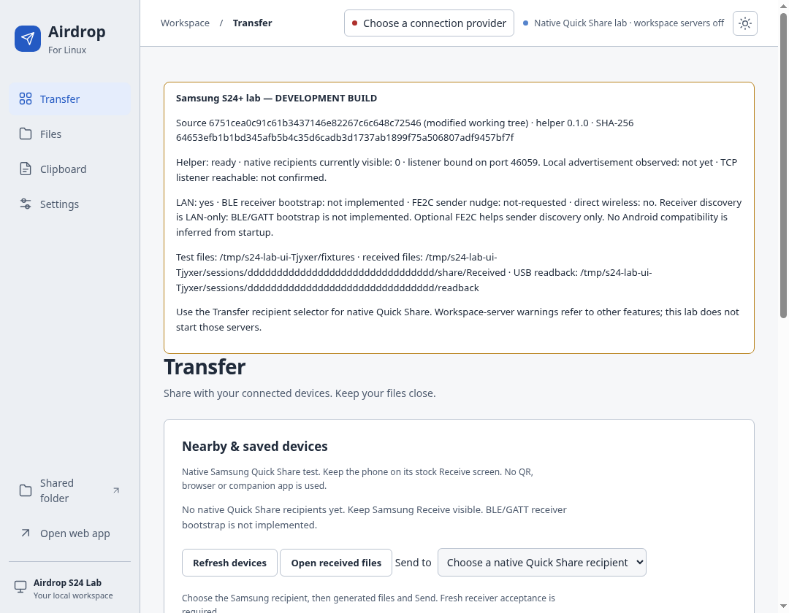
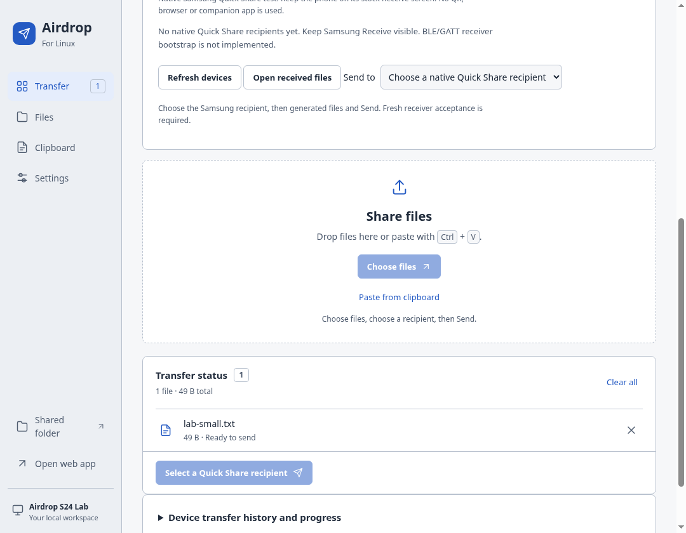

# Samsung Galaxy S24+ — owner-assisted native Quick Share test

This tests the development code from PR #21 (which targets PR #19), not the
installed stable application. No native Samsung success has been established
for this build. You are the physical tester; return the report and development
will continue from the first failing stage. No phone root, companion sharing
app or ADB is needed.

## 1. Prepare the Linux laptop

Open a terminal in this repository on branch `fix/quickshare-protocol-hardening`.
Use the exact commit supplied in the handoff. Close previous lab sessions first.
Normal installed Airdrop data and personal files are not used by this harness.

```sh
bash scripts/quickshare-android-lab.sh --preflight
bash scripts/quickshare-android-lab.sh --prepare
```

`--preflight` reads local system/build facts, hashes the helper if present and
performs its hello-only capability check (no receiver/radio starts). It never
installs dependencies or changes networking. It prints distro-specific package
instructions if tools are missing. Install system packages yourself, reviewing
any OS permission prompt. Rust must match `network/quickshare/rust-toolchain.toml`;
Node 26 is recommended (host minimum 24). Rustup may install the pinned toolchain
during the explicit build. `--prepare` uses npm's lockfiles, downloads Electron
through its installer, builds the real Rust helper, checks its hash, and copies
the current application core into the source desktop. This can take several
minutes. It does not install system packages, modify services or configure radios.

The default private lab directory is `.cache/quickshare-lab` in this checkout.
Use `--workspace /a/short/private/path` on **every operation** if your checkout
path is too long for a Unix socket or you want another independent lab.
Do not use sudo to run the harness. Do not disable Electron's sandbox.

Generated disposable files are in `.cache/quickshare-lab/fixtures`:

- `lab-empty.bin` (zero bytes; some Android pickers cannot select it).
- `lab-small.txt` (the first test), `lab-unicode-日本語-é.txt`.
- `lab-binary.bin` (64 KiB + 1 byte).
- `lab-image.jpg`, `lab-image.png` (valid tiny generated images, no camera data).
- `lab-medium.bin` (2 MiB + 17 bytes).
- `lab-batch-1.txt` through `lab-batch-8.txt` (multi-file test).
- `fixture-manifest.json` and `SHA256SUMS` (reference hashes, not transfer files).

The lab file picker starts in this fixture folder, and lab sends refuse personal files or modified fixture bytes.
No large file is generated automatically. Existing changed fixtures are not
overwritten: choose a new workspace instead.

## 2. Prepare the S24+

1. Turn on Wi-Fi and Bluetooth on the phone through its normal settings. Connect
   phone and laptop to the same ordinary Wi-Fi/LAN. Avoid guest networks with
   client isolation. The laptop can use Ethernet on the same LAN.
2. Keep the phone unlocked near the laptop. Disable neither authentication nor
   Android permission checks. Permit stock Quick Share's normal Nearby devices
   prompts when Android asks.
3. Open Samsung **Settings → Connected devices → Quick Share**, or long-press
   the **Quick Share** Quick Settings tile. Labels vary with One UI versions.
4. For receiving, choose **Who can share with you → Everyone / Everyone for
   10 minutes**, if available, and keep the Receive screen open. Renew the
   interval if it expires. Contacts-only is not this unauthenticated-peer test.
5. Note Android and One UI versions in **Settings → About phone → Software
   information**. Find Quick Share version through its own Settings/About or
   **Settings → Apps → Quick Share**. Record `unknown` if not exposed. Do not
   copy serial numbers, IMEI, account names, addresses or verification codes.
6. If **Share with Apple devices** exists, note whether it is on/off for your
   manual follow-up. Do not change unrelated networking settings automatically.

To put test sources on Samsung without another app: connect a USB cable, choose
**File transfer / Android Auto** on the phone's USB notification, unlock it, and
use the Linux file manager's phone storage view. Copy only the generated transfer
files into **Internal storage → Download → S24QuickShareLab**. Disconnect USB
before each native Quick Share attempt. If USB/MTP is unavailable, do Linux→phone
first when discoverable, then select those received fixtures for the reverse
trial; record that dependency honestly.

## 3. Start the actual development desktop

```sh
bash scripts/quickshare-android-lab.sh --start
```

Run this in your normal graphical desktop terminal. It launches this checkout's
Electron executable with `AIRDROP_EXPERIMENTAL_QUICK_SHARE=1`, a unique private
application-data directory and a fresh receiving folder for this session. It
never runs `airdrop-linux` from your PATH or launches the installed v1.9.0 app.

Identify the right window by **Airdrop S24 Lab — DEVELOPMENT <commit>** in its
title and **Samsung S24+ lab — DEVELOPMENT BUILD** panel. The panel shows full
commit, modified-source indication, helper version/hash, status, fixture path,
received-file path and native-recipient count. The terminal prints sanitized
status. To refresh local transport observations:

```sh
bash scripts/quickshare-android-lab.sh --status
```

Expected startup: helper `ready`, receiver listener reachable, and eventually
`ownObserved: true` for the locally observed Quick Share mDNS advertisement.
An observed advertisement is a local check, not proof Samsung sees it.
The lab deliberately does not start workspace/clipboard web servers. The header
labels them off, and the native-only lab hides QR/workspace routes and prevents
those sends. Use the Transfer view and native recipient selector.

**The current baseline is LAN-only. BLE/GATT receiver bootstrap and direct
wireless are not implemented.** If Samsung's current Quick Share requires BLE
for discovery, the phone may not list Linux even while local startup passes.
Do not install a phone sharing app, enter an IP or scan a QR to turn that native
failure into a pass. Return the discovery result so the next build targets it.

The screenshots below come from an automated Linux-only lab rehearsal with no
phone connected. They show the development UI, not successful Samsung discovery.
Your commit, paths, hash and recipient list will differ.





## 4. Samsung → Linux: first small text trial

1. On Samsung, open stock **My Files → Internal storage → Download →
   S24QuickShareLab**. Long-press `lab-small.txt`.
2. Tap **Share → Quick Share** in the Android/Samsung share sheet. Do not choose
   a browser, link, QR, Samsung Private sharing or another transfer application.
3. Watch for **Airdrop S24 Lab** in native nearby recipients for up to 30 seconds.
   If absent, record C=fail. Later connection/authentication/transfer stages are
   **not-tested**, not failed. Note if the phone leaves its Wi-Fi association
   when opening Send; do not paste SSID/address details into reports.
4. If listed, select **Airdrop S24 Lab**. Linux should show a native receive
   confirmation for one file, its size and comparison code. Compare it visually
   with the phone's code when shown. Never type, photograph or save the code in
   a report. If different, **Decline** and report F=fail.
5. On matching codes, click **Accept files** in Airdrop Linux. This is a fresh
   decision for each transfer. No automatic trust is granted.
6. Wait for the actual phone result and Linux activity outcome. No file should
   appear as received before acceptance; no partial file should be labelled
   complete. The lab panel/terminal shows this session's receiving-folder path.
7. Collect. The default command asks which direction/case and stages you observed:

```sh
bash scripts/quickshare-android-lab.sh --collect --direction samsung-to-linux --case lab-small.txt --archive
```

Incoming fixture hashes are computed from this session's private receiving
folder automatically. If file readback is missing or mismatched, integrity does
not pass even if a progress bar reached 100%.

## 5. Linux → Samsung: first small text trial

1. On Samsung, open stock Quick Share **Receive**, make visibility Everyone for
   its allowed interval, and keep the screen unlocked.
2. In the development Airdrop window choose **Transfer → Choose files**, then
   select `lab-small.txt` from the fixture folder printed by the harness.
3. Choose the phone in the recipient selector. Its label may be your normal
   phone name or an anonymous nearby-device label. It should carry the
   **Quick Share (experimental)** route. QR and workspace routes are hidden in
   lab mode. If Samsung never appears, record D=fail and E–I as
   not-tested. Refresh/visibility expiry and the LAN-only limitation matter here.
4. Select **Send to device**. Samsung must show its **native Quick Share receive
   prompt**. Compare codes when shown, then Accept on Samsung.
5. Wait for Samsung's actual completed/failed result. Linux currently reports
   **Files sent · recipient completion unconfirmed** after sending bytes. That
   is truthful uncertainty, not independently confirmed delivery. Record the
   actual phone result separately in stage I.
6. For independent integrity, reconnect USB only after the transfer finishes.
   Find the newly received file in stock My Files/Recent or Downloads (the exact
   Quick Share destination varies). Copy it through the Linux file manager into
   the fresh **USB readback folder** printed by `--start` and the lab panel
   (inside this session directory). It is created automatically and starts empty.
   Do not add personal files. Use the actual newly received Quick Share output,
   not the original phone source folder from setup. Preserve the generated
   filename; if Samsung renamed a duplicate, rename only the USB copy back to
   the original fixture name in the empty readback folder without editing bytes.

```sh
bash scripts/quickshare-android-lab.sh --collect --direction linux-to-samsung --case lab-small.txt --archive
```

The command checks this session's readback folder automatically. If you chose
another empty fixture-only folder, add `--readback /absolute/path/to/that/folder`.
No USB readback means J=not-tested, not pass. No ADB is needed. Optional ADB is
outside the ordinary harness: only use authorized USB debugging to obtain version
metadata or pull these specific test files, then disconnect for transfer. Never
attach raw logcat/dumpsys output, packet captures or entire phone directories.

## Optional: FE2C sender-discovery experiment

Start with the default LAN-only trial above. If Linux does not discover Samsung
while the phone's native Receive screen is open, an optional **sender nudge** is
available. It is not a BLE receiver or an Android compatibility claim:

```sh
bash scripts/quickshare-android-lab.sh --stop
bash scripts/quickshare-android-lab.sh --prepare --ble-fastinit
# Open Samsung Quick Share Receive before starting the next two-minute trial.
bash scripts/quickshare-android-lab.sh --start
```

Use your normal Linux Bluetooth settings to turn Bluetooth on yourself if needed.
The harness never powers/unblocks it, changes discoverability, scans, adds policy
rules, requests root or reconfigures networks. The optional feature registers a
legacy FE2C broadcast for at most **120 seconds**; stopping the helper also drops
its registration. Stop/start a fresh trial after expiry. OS permission decisions
remain under your control. `--prepare` without the option restores the baseline.

Look at `bleFastInitState` in `--status` or the lab panel:

| Result | Meaning / next step |
| --- | --- |
| registered-for-120s | BlueZ granted registration; air visibility and Samsung behavior remain unverified |
| expired | Initial two-minute lease elapsed; stop/start for another foreground trial |
| bluez-unavailable / no-adapter | System BlueZ service/controller could not be used; check normal OS Bluetooth settings |
| bluetooth-off | Turn Bluetooth on in OS settings, then restart the lab |
| permission-denied | Respect the OS policy/prompt; do not run the harness with sudo or disable controls |
| not-supported / adapter-busy | Controller/policy cannot currently register this advertisement; return the report |
| bluez-timeout / bluez-operation-failed | Registration did not complete; return the sanitized category |
| not-requested | Baseline mode; no Bluetooth registration attempted |

This can elicit an Android receiver's LAN advertisement for **Linux→Samsung**.
It does **not** advertise Linux as an FEF3/GATT receiver, so it does not resolve
Samsung→Linux BLE bootstrap. Full bounded GATT/weave plus authenticated LAN
upgrade is still pending; unsafe upstream experimental features are not enabled.
The cloud verified compilation, advertisement bounds and graceful no-BlueZ
fallback, not successful radio emission. Return separate baseline/optional
archives so behavior can be compared honestly.

## 6. Record distinct stages and failures

| Stage | What you actually observe |
| --- | --- |
| A | Helper starts (automatic local evidence) |
| B | Local mDNS endpoint is observed (automatic; not Samsung discovery) |
| C | Samsung native Send lists Linux |
| D | Linux native recipient selector lists Samsung |
| E | Selecting recipient establishes a native connection/prompt |
| F | Codes match visually; do not record the code |
| G | Receiver accepts |
| H | Receiver receives the complete byte transfer |
| I | Receiver's native UI confirms final successful outcome |
| J | Independently read fixture bytes match SHA-256 |

The report separates user observations from automatic evidence. Its JSON timeline
includes named native protocol transitions (connection request, UKEY2, paired-key
exchange, introduction and transfer) with relative timing and per-run aliases,
not packet contents, keys or raw endpoint identities. Failure at C/D
leaves E–J untested unless you actually exercised them. A discovery failure is
not “Android protocol incompatible.” For C failure in this baseline the report
says **Native Samsung discovery unavailable — BLE bootstrap not implemented**,
with a qualification that missing BLE has not been proven to be the sole cause.

Listed recipient but no prompt is a connection/handshake-stage problem. A code
mismatch is an authentication problem: reject. Accepted prompt followed by stall,
interruption, hash mismatch or missing final success is a transfer/finalization
problem. Retain the exact development commit and report for the next iteration.

For scripts/noninteractive collection, this is a truthful discovery-only example:

```sh
bash scripts/quickshare-android-lab.sh --collect --non-interactive --direction samsung-to-linux --case lab-small.txt --record C=fail,E=not-tested,F=not-tested,G=not-tested,H=not-tested,I=not-tested --archive
```

Never use that example to claim observations you did not make. J is not accepted
as a yes/no override; it requires fixture readback. Version inputs are restricted
and arbitrary personal notes/raw logs are intentionally not exported.

After small text, repeat empty (if the picker supports it), Unicode, PNG/JPEG,
binary, medium and `--case batch` (select all eight batch files). Test each
direction separately. Later trials: decline, cancel and interruption. Set
`--scenario decline`, `cancel` or `interrupt` when collecting those intentional
negative cases. Stop/start between independent trials for a fresh inbox. Keep
screenshots, if needed, limited to non-sensitive UI; crop/obscure codes, peer
names, addresses, notifications and personal files yourself before sharing.

## 7. Stop and send evidence back

```sh
bash scripts/quickshare-android-lab.sh --stop
```

Only the harness's live child process is signalled through its private supervisor.
There is no killall, stored-PID termination, global service stop, firewall/radio
reset or privilege escalation. Temporary control sockets/locks are removed.
Fixtures, per-session received files and sanitized evidence remain for collection.
You may collect after stopping. Do not delete the lab until its report is saved.

`--collect` prints the exact paths of:

- `quickshare-test-report.md`
- `quickshare-test-results.json`
- With `--archive`, a timestamped local `.tar.gz` containing only those two files.

Read them before attaching. No personal files, raw application logs, device
identifiers, private addresses, PINs or captures are included, and nothing is
uploaded automatically. Attach the two reports or the sanitized archive in this
Codex conversation (or manually to PR #21). Return one archive per direction or
failed trial. Timestamped archives preserve earlier trials; the two unarchived
report files are replaced by the next collection.

Also tell Codex, in plain words, which direction you tried and the first stage
that did not work. No physical result is assumed until you return it. We will
correlate that evidence, fix the relevant stage, add a regression and give you a
new exact commit for the next S24+ attempt. Pixel and production release gates
remain separate; owner-assisted Samsung testing is an ongoing checkpoint.
